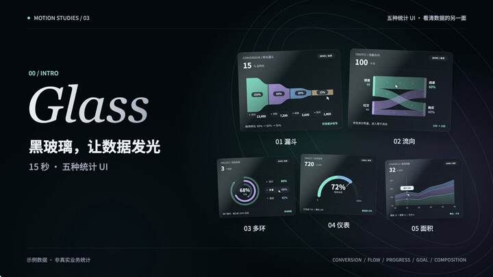
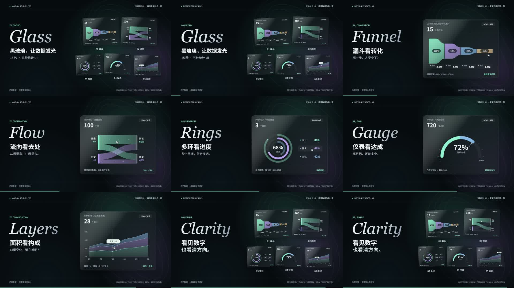

# vibe-charts2 · 黑色毛玻璃图表实验室

**15 秒，五种统计 UI。** 漏斗看转化、桑基看流向、多环看进度、仪表看达成、面积看构成。延续前作的大字与左右分栏，改为黑色磨砂玻璃、柔和透光及薄荷 / 灰紫 / 冰蓝色图形。

[打开交互网页](https://jdb156158.github.io/vibe-charts2/) · [播放完整有声视频](https://jdb156158.github.io/vibe-charts2/#film) · [下载 MP4](https://github.com/Jdb156158/vibe-charts2/raw/refs/heads/main/media/charts-glass-15s.mp4) · [下载视频源码 ZIP](media/charts-glass-source.zip)

## 视频展示

点击下方动图打开完整视频。README 预览为 720px / 10fps，原片为 **1920×1080 · 60fps · 15.000 秒 · H.264 Main + AAC-LC**。无旁白，配短字幕与 Python 合成的 128 BPM 音乐、音效。

[](https://jdb156158.github.io/vibe-charts2/#film)

开场、片尾均展示完整五种图表，并标注编号和名称。所有数值均为合成演示数据，非真实业务统计。

## 亲手操作

| 图表 | 操作 | 与影片对应的效果 |
|---|---|---|
| 漏斗 | 悬停 / 点按阶段，或左右按钮 / 方向键 | 聚焦阶段，查看人数及转化 |
| 桑基 | 悬停 / 点按来源或色带，点击「显示全部流向」复位 | 隔离搜索或社交流量，显示去向 |
| 多环 | 悬停 / 点按圆环或图例，或左右按钮 / 方向键 | 聚焦独立目标，中心百分比切换 |
| 仪表 | 拖动滑块、点按圆弧，或方向键 | 数字、弧长与指针同步更新 |
| 面积 | 指针沿月份移动 / 点按，或左右按钮 / 方向键 | 游标、高亮节点与渠道合计联动 |

所有模式支持「重播动效」。标签支持左右键、Home / End。手机支持点按，遵循系统减少动态效果设置。网页复用影片中的图表绘制函数、字体、颜色和示例数据，选中状态由真实操作控制。仪表初始值为影片中的 72%，可交互调整至 0–100%。

## 提示词

> 从 BoardUI 公开展示中挑选五种统计 UI，制作一支 15 秒内的快节奏讲解视频。使用漏斗、桑基、多重进度环、半圆仪表、堆叠面积。沿用前作的左侧英文衬线大字与中文短句、右侧图表及编号结构，改为近黑背景、黑色磨砂玻璃、透光光晕、细颗粒和清晰文字。每种图表只讲一个用途，动作解释用途。首尾完整展示五种。使用确定性 Canvas 时间函数逐帧生成，检查关键帧，Python 合成配乐与音效，FFmpeg 编码 H.264 + AAC。再制作与视频一致的可交互网页，支持鼠标、手机、键盘及动效重播。上传视频、源码、动态预览、提示词和制作步骤，部署到 GitHub Pages。

- [完整提示词](docs/PROMPTS.md)
- [制作与部署步骤](docs/MAKING.md)
- [影片分镜、参考来源和数据核对](film/treatment.md)
- [视频源码说明](film/README.md)
- [参考与授权](docs/CREDITS.md)

## 制作过程

1. 研究 BoardUI 的漏斗、桑基、径向和面积图公开预览，核实图形机制，写分镜与数据检查表。
2. 用 Canvas 重建图形。卡片裁剪并模糊采样背景，再叠加深色透光层、反光与固定种子微颗粒。
3. 以 `window.draw(t)` 驱动画面，等待字体加载。检查九张关键帧，两轮调整指针遮挡和玻璃质感。
4. Python 合成 128 BPM、8 小节配乐与 UI 音效；Playwright 导出 900 帧；FFmpeg 编码 15 秒 MP4。
5. 网页将自动选中项改为指针、点按、滑块和键盘控制，保留原图表坐标与比例。
6. 检查五种模式、移动端、键盘及视频播放，将静态文件发布到 GitHub Pages。

## 本地运行

网页无构建步骤，在仓库根目录执行：

```sh
python3 -m http.server 8000
```

访问 `http://localhost:8000`。重新制作影片需要 Node.js、Python + numpy、FFmpeg 和 Chrome，详见 [制作步骤](docs/MAKING.md)。

## 文件结构

```text
index.html              交互网页入口
site/style.css          黑色毛玻璃视觉与响应式布局
site/charts.js          五种图表及指针、触屏、键盘、滑块交互
film/                   原始视频源码、字体、音频、分镜与渲染工具
media/                  MP4、动态预览、封面、总览、视频源码 ZIP
docs/                   提示词、制作步骤、参考与授权
.nojekyll               GitHub Pages 静态发布标记
```

## 成片总览


